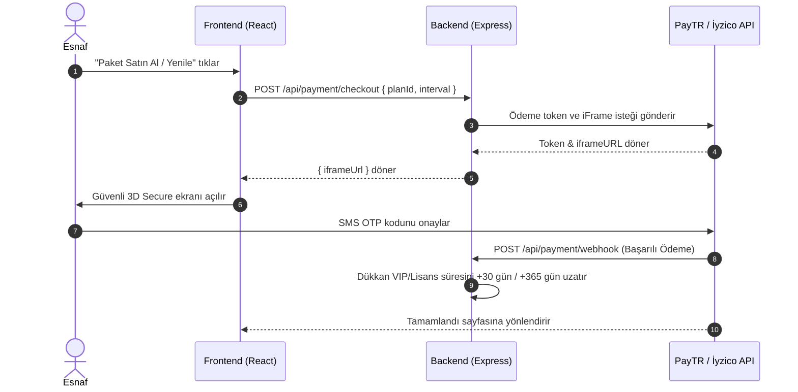

# 💳 Dükkanım Yanımda — Ödeme, Fiyatlandırma & FinTech Şartnamesi
*Hazırlayan: OpenCode Zen Payment & FinTech Architect | Yönetici: Antigravity*

Bu şartname, **Dükkanım Yanımda** platformunun gelir modelini, Türkiye regülasyonlarına (TCMB / BDDK) uygun sanal POS entegrasyonunu ve dükkan içi komisyonsuz FAST QR tahsilat mekanizmasını tanımlar.

---

## 🏷️ 1. Fiyatlandırma Modeli & Paketler

| Paket | Aylık Fiyat | Yıllık Fiyat (2 Ay Hediye) | Dahil Olan Özellikler |
| :--- | :--- | :--- | :--- |
| **Ücretsiz Deneme (Trial)** | ₺0 / 14 Gün | — | Tüm temel özellikler, 1 kullanıcı, sınırsız müşteri |
| **Esnaf Paketi (Standart)** | **₺199 / Ay** | **₺1.890 / Yıl** | Kasa & Gün Sonu, Veresiye Defteri, Stok & Kritik Uyarı, Sektörel Panel, WhatsApp Bildirimleri |
| **Pro & Zincir (Genişletilmiş)** | **₺399 / Ay** | **₺3.790 / Yıl** | Tüm Esnaf özellikleri + Çoklu Personel & Maaş Takibi, Öncelikli VIP Yapay Zeka Danışmanı, Sınırsız Veri Yedekleme |

---

## 🔌 2. Sanal POS Altyapısı: PayTR & İyzico Entegrasyonu

### Tercih Edilen Entegrasyon: PayTR iFrame / Direct API
1. **Neden PayTR?**
   - Türkiye'de en yaygın esnaf ve KOBİ ödeme geçidi.
   - Düşük komisyon oranları ve ertesi iş günü hesaba aktarım.
   - Tekrarlayan ödemeler (Subscription / Recurring Billing) desteği.

### Akış Mimarisi:

---

## ⚡ 3. Dükkan İçi FAST Karekod ile Komisyonsuz Tahsilat

Esnafların POS komisyonundan (%2-4) kaçınmak için müşterilerinden IBAN/Havale ile ödeme aldığını biliyoruz. Ancak müşterinin IBAN'ı tek tek yazması vakit kaybettirir.

### Çözüm: TR-Karekod Standartlarında Dinamik IBAN QR
- Dükkan sahibi profilinde IBAN numarasını ve banka adını bir defa kaydeder.
- Kasa ekranında "Hızlı Para Al" seçildiğinde ve "Havale / FAST" tıklandığında:
  - Müşteriye anında telefon ekranında taranabilir bir **FAST Karekod** gösterilir.
  - Müşteri banka uygulamasını açıp QR kodu okuttuğunda: **Alıcı Adı, IBAN ve Tam Tutar otomatik dolar.**
  - Müşteri sadece "Gönder"e basar.
  - **Esnaf için komisyon oranı: %0! Sıfır masraf.**
